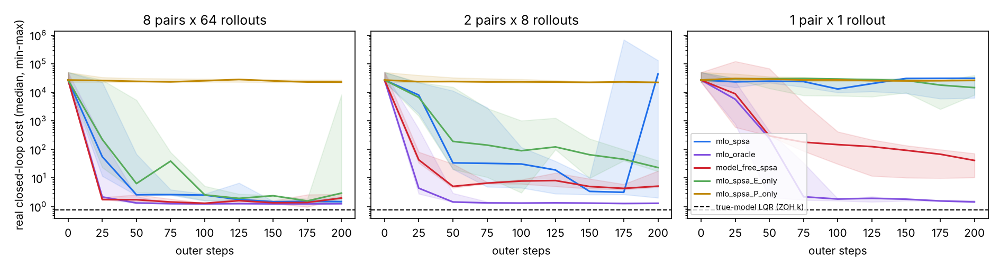

# Pilot: MLO on a two-level hierarchical LQ world model

`mlo_lq_pilot.py` (JAX, CPU). Results are in `results/`, the table in `results/summary.md` and the figure in `results/curves.png`.

## Setup

- **True system.** 12-dimensional linear state and 2 controls. The block structure is hidden by a random rotation:
  - 4 cost-relevant dimensions: 2 slowly *unstable* modes with weak actuation, and 2 stable modes with strong actuation and large variance;
  - 8 cost-irrelevant distractor dimensions with large noise.
  
  This plants objective mismatch at **both** levels. Prediction- or reconstruction-optimal level-1 abstractions pick up distractors. Variance-optimal level-2 abstractions pick the stable modes rather than the unstable ones that need control.
- **Levels.** L1: latent linear model $z=Ex$ (d=4), ridge LS on 6,000 random-action real steps. L2: stride-4 model $h=Pz$ (d=2), fit to L1 imagination under held macro-actions, plus a quadratic cost model fit to real k-step costs. L3: LQR on the L2 model (400 unrolled Riccati iterations). Outer: $(E,P)$ minimizing $\log J_{\text{real}}$ of the zero-order-hold policy.
- **Hypergradients.** Exact through L3→L2→L1 (autodiff through the LS normal equations and the unrolled Riccati). Two outer gradients, $dJ/dK$:
  - **oracle**: pathwise through the true simulator; an upper bound, not realizable on a real system;
  - **SPSA**: black-box antithetic perturbation of the gain, using real rollouts only.
- **Controls.**
  - Decoupled PCA and decoupled RRR (reduced-rank regression, i.e. prediction-optimal) hierarchies.
  - Ablations that update only E or only P.
  - A **model-free SPSA** search directly on the full gain $K\in\mathbb R^{2\times12}$, with an *identical* real-rollout budget and the same initialization as MLO-SPSA.
  - Reference: LQR on the true model with the same stride-4 zero-order hold (cost 0.76).
- **Protocol.** 3 seeds × 3 outer-loop real-data budgets × 200 outer steps. The cost reported is the real closed-loop cost from 256 rollouts of 200 steps on fixed evaluation noise. Cells show median [min, max] over seeds.

## Results

| method | big: 8 pairs × 64 rollouts (122,880 real steps / outer step) | mid: 2 × 8 (3,840) | small: 1 × 1 (240) |
|---|---|---|---|
| true-model LQR, ZOH k=4 (reference) | 0.76 | 0.76 | 0.76 |
| no control | 3.08e4 | 3.08e4 | 3.08e4 |
| decoupled PCA hierarchy | 3.18e4 [3.04e4, 4.65e4] | same | same |
| decoupled RRR hierarchy | 2.68e4 [2.29e4, 4.99e4] | same | same |
| MLO-SPSA, P only | 2.27e4 [2.20e4, 2.71e4] | 2.20e4 [2.18e4, 2.46e4] | 2.61e4 [2.47e4, 2.81e4] |
| MLO-SPSA, E only | 2.95 [1.31, 8.24e3] | 23.2 [17.1, 40.5] | 1.45e4 [8.08e3, 3.93e4] |
| **MLO-SPSA, E and P** | **1.49 [1.41, 2.18]** | 4.34e4 [2.03, 1.31e5] | 3.08e4 [6.33e3, 3.37e4] |
| model-free SPSA on K (same budget) | 1.99 [1.92, 2.72] | **5.17 [4.78, 17.7]** | **41.1 [10.4, 71.9]** |
| MLO-oracle (upper bound) | 1.26 [1.24, 1.26] | 1.30 [1.27, 1.31] | 1.45 [1.42, 1.66] |

## What the pilot does and does not show

1. **Mismatch compounds across levels (confirmed).** Hierarchies trained level-by-level with prediction or variance criteria are no better than applying no control (around 3×10⁴). Each level is locally reasonable, but L1 spends capacity on distractors and L2 keeps the high-variance stable modes instead of the unstable ones.
2. **Nesting fixes it when the outer gradient is good (confirmed).** With an accurate outer gradient, MLO over both levels reaches 1.26–1.45 (optimum 0.76) at every budget. The alignment of $PE$ with the unstable modes rises from 0.02 to 0.49.
3. **Both levels must be optimized (confirmed).** Updating only P never recovers, because L1 has already discarded the information. Updating only E helps but is slower and less reliable than updating both. This is the core argument for *multi*-level over bilevel optimization.
4. **The zeroth-order outer gradient is the bottleneck (negative result).**
   - At a large real budget, MLO-SPSA beats model-free search on the gain (1.49 vs 1.99).
   - At moderate and small budgets, MLO-SPSA is unstable or fails. At mid budget it was near 3 at step 175 and then diverged; there is no step-size decay and no best-iterate selection.
   - Model-free SPSA degrades gracefully.
   
   So the pilot **does not** yet support a sample-efficiency claim. The gap between MLO-oracle and MLO-SPSA says the paper needs a low-variance, *real-data* outer gradient, such as an OMD-style critic trained on real transitions or a value-equivalence residual. Zeroth-order search is not enough. This is now the top technical risk (see `proposal.md` §5).

### Caveats

- A linear toy with planted distractors. The decoupled failure is extreme by design.
- 3 seeds only.
- No hyperparameter tuning for any method; lr is 0.02 for all.
- The "relevance" diagnostics are computed against the known ground-truth rotation and are only for analysis.
